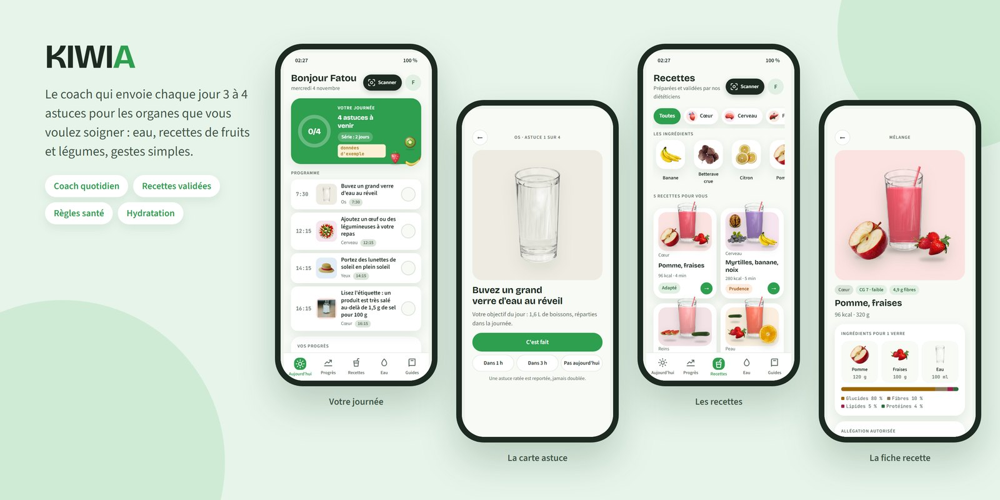
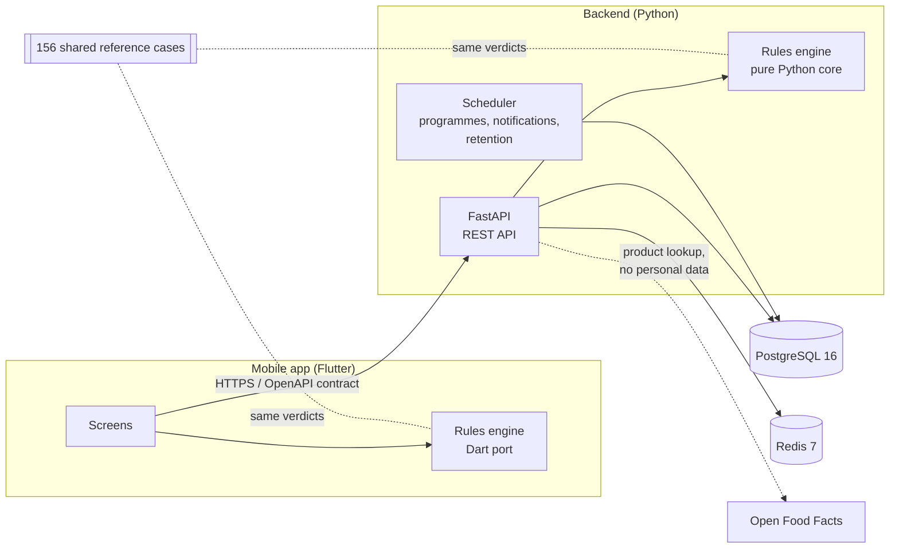

# KIWIA

**A daily nutrition coach organised by organ.** Every day, KIWIA sends 3 to 4 small, actionable tips for the organs a person wants to look after: water, fruit and vegetable recipes, simple habits. A health rules engine filters every recommendation against the person's profile.

> **Showcase repository.** The source code is private. This page describes the product, the architecture and the engineering choices.
> Personal project, designed and built solo. Status: functional prototype, in development.

  

## The problem

Nutrition advice online is scattered, often wrong, and ignores each person's conditions and medication. A recipe that is good for one person can be risky for another, for example too much potassium for someone with kidney disease, or too much vitamin K for someone on anticoagulants.

## What KIWIA does

- **Daily programme**: 3 to 4 tips a day, scheduled at the right time and sent as notifications. A missed tip is postponed, never doubled.
- **Personalised recipes**: a catalogue of more than 12,000 fruit and vegetable recipes across 11 organs, each one checked by the rules engine against the user's profile ("Adapted", "Caution", or excluded).
- **Product scanner**: scan a barcode and get a verdict for your profile.
- **Progress**: streaks, regularity per organ, hydration tracking.
- **Expert workflow**: every tip and recipe stays a draft until a dietitian validates it; only EU-authorised health claims are shown.

## Architecture

- **A pure rules engine.** The health logic (nutrition calculations, rules, scanner verdicts, coaching programme) lives in a core module with no network or database access, so it is fast to test and easy to audit.
- **Two engines, one truth.** The rules also run on the phone, in Dart, so the app keeps working offline. Both engines must reproduce the same verdicts on a shared file of **144 reference cases and 12 safety cases** (unknown values, allergens, exclusions), generated by an independent calculation.
- **Contract first.** The API is described by a complete OpenAPI contract, which the mobile app follows.
- **Versioned rules.** Any change to a health rule creates a new rules version that must be validated by an expert.

## Engineering highlights

| Area | What is in place |
|---|---|
| **Testing** | 511 backend test functions (pytest), including database constraint tests on a temporary PostgreSQL; 30 Flutter tests, including the shared reference cases |
| **CI** | GitHub Actions: lint (Ruff) and the full test suite against a PostgreSQL 16 service on every push and pull request |
| **Database** | PostgreSQL schema with 14 versioned migrations and a custom migration runner, partitioned tables, constraint tests in SQL |
| **Security** | JWT with refresh tokens, sign-in with email, Google and Apple, mandatory two-factor authentication for the team, health data encrypted at rest with key rotation, access to health data logged |
| **Privacy (GDPR)** | Consent management, data export, account deletion within 30 days, automatic clean-up of inactive accounts, no health data in notifications, logs, URLs or analytics |
| **Operations** | Docker Compose for the full stack (API, PostgreSQL, Redis, scheduler), a scheduler that can run in several copies without duplicates |
| **Subscriptions** | App Store and Google Play receipt handling and server notifications with signature checks |

## Data

- Food composition: **Ciqual table (Anses)**, Licence Ouverte, imported by a dedicated tool with a review report for the dietitian.
- Scanned products: **Open Food Facts** (ODbL). Neither identity nor profile is ever sent.
- Health claims: **Regulation (EU) No 432/2012**.

## Tech stack

**Backend**: Python 3.12+ · FastAPI · PostgreSQL 16 · Redis · Docker · pytest · Ruff · GitHub Actions
**Mobile**: Flutter · Dart · go_router · provider · secure storage · local notifications
**Design**: design system, UML and database diagrams made before implementation

## Roadmap

- [x] Rules engine and its Dart port, with shared reference cases
- [x] REST API: accounts, profile, programme, progress, scanner, subscriptions, expert workflow
- [x] Flutter app, wellness version
- [ ] Dietitian validation of all tips and recipes
- [ ] Real photo-scan and receipt verification providers
- [ ] Health-data-certified (HDS) hosting and store release

---

*KIWIA gives general advice and does not replace medical advice.*
